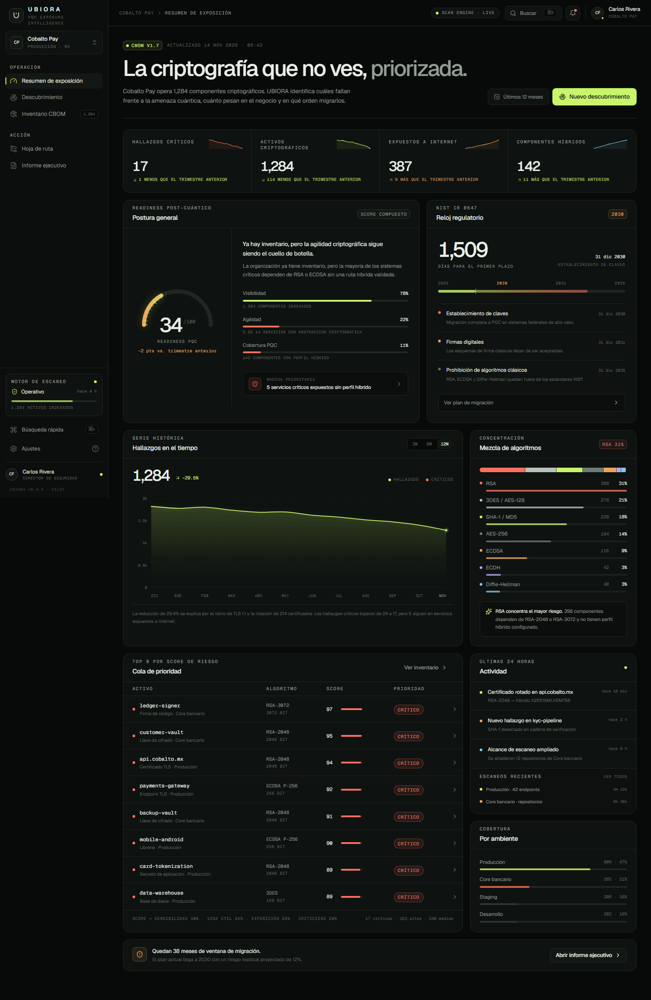

# UBIORA

**Plataforma de descubrimiento y priorización de riesgo criptográfico post-cuántico.**

UBIORA permite a una empresa descubrir qué algoritmos criptográficos usa realmente, priorizar los activos que representan mayor riesgo frente a la computación cuántica y convertir ese inventario en una hoja de ruta de migración alineada a los estándares PQC del NIST.

> MVP académico para la materia de **Innovación y Tecnología**. La aplicación **arranca vacía**: el inventario se construye con escaneos reales o se genera un conjunto de demostración solo cuando el usuario pulsa **“Cargar ejemplo”**.



## El problema

La mayoría de las organizaciones no sabe qué criptografía usa, en qué sistemas, ni con qué criticidad. Sin un **Cryptographic Bill of Materials (CBOM)** no hay forma de planear la migración post-cuántica. Los plazos regulatorios ya existen y el riesgo *harvest now, decrypt later* convierte los datos capturados hoy en una obligación futura.

UBIORA no vende la migración completa: vende **visibilidad y priorización**. El primer paso que nadie ha dado.

## Qué incluye este MVP

| Módulo | Qué demuestra |
| --- | --- |
| **Resumen de exposición** | KPIs calculados desde los activos reales: score de readiness, reloj regulatorio, distribución de prioridades, mezcla de algoritmos y estado de escaneos. |
| **Inventario CBOM** | Componentes filtrables por ambiente, algoritmo y prioridad; selección masiva y exportación CSV / CycloneDX. |
| **Descubrimiento** | Escaneo TLS real (backend Python opcional o fallback del navegador), consola en vivo y resumen de hallazgos. |
| **Hoja de ruta** | Plan genérico alineado a NIST: fases, entregables, dependencias e iniciativas priorizadas. |
| **Informe ejecutivo** | Documento editorial imprimible con hallazgos, decisiones solicitadas y metodología del scoring. |
| **Cómo funciona** | Guía en lenguaje claro con el flujo del producto, glosario mínimo, mapa de pantallas y guion de demo. |

La interfaz incluye además un **recorrido guiado** que lleva por las cinco pantallas paso a paso, búsqueda global (`⌘K` / `Ctrl+K`), notificaciones, drawer de detalle por activo y navegación responsive.

## Stack

- **React 19** + **TypeScript**
- **Vite 8**
- **Tailwind CSS 4** con tokens de diseño propios
- **React Router 7**
- **Lucide** para iconografía
- **Geist** / **Geist Mono** / **Newsreader** auto-hospedadas (sin dependencias de red en la demo)

El escaneo TLS real vive en Python (`scanner/`): `scanner/server.py` expone una API local en `http://localhost:8080/api/scan` y `scanner/engine.py` calcula el riesgo y genera el CBOM. Si el backend no está activo, la interfaz cae a un generador en el navegador para no romper la demo. La arquitectura está documentada en [`docs/03-arquitectura.md`](docs/03-arquitectura.md).

## Desarrollo local

Requisitos: Node.js 20+ y npm 10+.

```bash
cd app
npm install
npm run dev
```

La aplicación queda en `http://localhost:5173`.

```bash
npm run build      # Typecheck + build de produccion
npm run preview    # Previsualizacion del build
npm run lint       # Oxlint
```

## Estructura del repositorio

```
.
├── app/                          # Aplicación React + Vite
│   ├── public/                   # Favicon y assets estáticos
│   └── src/
│       ├── components/
│       │   ├── brand/            # Identidad
│       │   ├── charts/           # Visualizaciones SVG a medida
│       │   ├── layout/           # Shell, sidebar y topbar
│       │   ├── tour/             # Recorrido guiado por las pantallas
│       │   └── ui/               # Primitivas: botones, badges, palette, toasts
│       ├── data/                 # Modelo, inventario simulado y hoja de ruta
│       ├── lib/                  # Utilidades, navegación y descargas
│       └── pages/                # Los cinco módulos y la guía "Cómo funciona"
├── docs/                         # Documentación de producto e ingeniería
│   ├── adr/                      # Architecture Decision Records
│   └── assets/screenshots/       # Capturas para documentación
├── scanner/                      # Motor de escaneo TLS en Python + API local (puerto 8080)
├── GUIA_USO_Y_EXPOSICION.md      # Guía de uso y exposición desde cero
├── GUIA_EMPRESA_Y_PROYECTO.md    # Empresa y proyecto explicados en simple
├── ProyectoFinal.pdf             # Memoria original del proyecto
└── README.md
```

## Documentación

| Documento | Contenido |
| --- | --- |
| [`docs/README.md`](docs/README.md) | Índice y orden de lectura. |
| [`docs/01-producto-y-alcance.md`](docs/01-producto-y-alcance.md) | Problema, propuesta de valor, alcance y no-alcance del MVP. |
| [`docs/02-requerimientos.md`](docs/02-requerimientos.md) | Requerimientos funcionales y no funcionales, historias y trazabilidad. |
| [`docs/03-arquitectura.md`](docs/03-arquitectura.md) | Stack, diagrama de arquitectura, flujo de datos y plan de integración. |
| [`docs/04-datos-y-scoring.md`](docs/04-datos-y-scoring.md) | Modelo de datos, fórmula de riesgo y mapeo a CycloneDX. |
| [`docs/05-diseno-de-interfaz.md`](docs/05-diseno-de-interfaz.md) | Sistema de diseño, tipografía, componentes y criterios visuales. |
| [`docs/06-calidad-y-pruebas.md`](docs/06-calidad-y-pruebas.md) | Estrategia de pruebas, matriz manual y limitaciones conocidas. |
| [`docs/07-plan-de-entrega-y-demo.md`](docs/07-plan-de-entrega-y-demo.md) | Sprints, guion de demo y siguientes pasos. |
| [`docs/08-guia-de-uso.md`](docs/08-guia-de-uso.md) | Guía en lenguaje claro, recorrido guiado y glosario. |
| [`CONTRIBUTING.md`](CONTRIBUTING.md) | Convenciones de commits, ramas y checklist de cambios. |

## Datos de demostración

Por defecto **no hay datos precargados**. El estado inicial es un espacio de trabajo vacío con nombre de organización genérico.

- El inventario se llena al ejecutar un **escaneo** en la pantalla de Descubrimiento.
- Si no hay backend Python, el navegador genera los activos a partir del dominio escaneado.
- Para una demo sin red existe **“Cargar ejemplo”**, que genera un conjunto determinista de assets de muestra.
- **“Vaciar”** elimina todo y regresa al estado inicial.

Todo se guarda en `localStorage` (`ubiora.assets.v1`, `ubiora.scans.v1`, `ubiora.org.v1`, `ubiora.demo.v1`). Ningún dato corresponde a una empresa real.

## Guías de uso y exposición

| Documento | Contenido |
| --- | --- |
| [`GUIA_USO_Y_EXPOSICION.md`](GUIA_USO_Y_EXPOSICION.md) | Instalación, recorrido completo desde cero, funcionalidades pantalla por pantalla, guiones de exposición de 10–12 y 5 minutos, resolución de problemas y preguntas del jurado. |
| [`GUIA_EMPRESA_Y_PROYECTO.md`](GUIA_EMPRESA_Y_PROYECTO.md) | La empresa y el proyecto explicados en lenguaje sencillo: problema, glosario, mercado, competencia, precios, proyecciones, FODA, fases y conexión con la app. |

## Equipo

- **Carlos Fernando Rivera Leal** — Dirección General / Arquitectura de Producto.
- **Alex Guillermo Martínez Martínez** — CTO / Ingeniería de Desarrollo.

Proyecto académico de Ingeniería en Computación, 5.º semestre. Profesor: Rodrigo Antonio Campos Villarreal.
