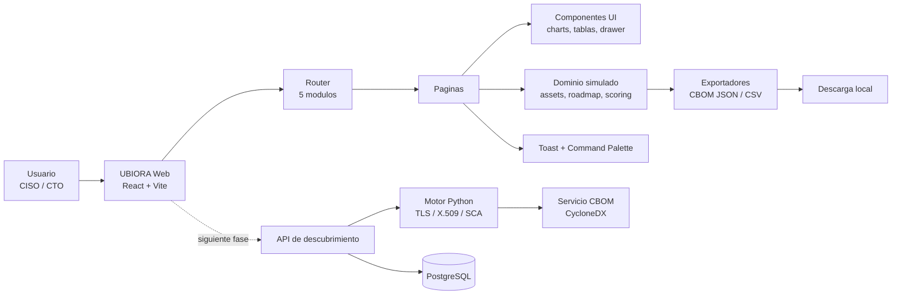
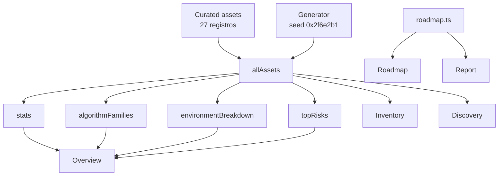
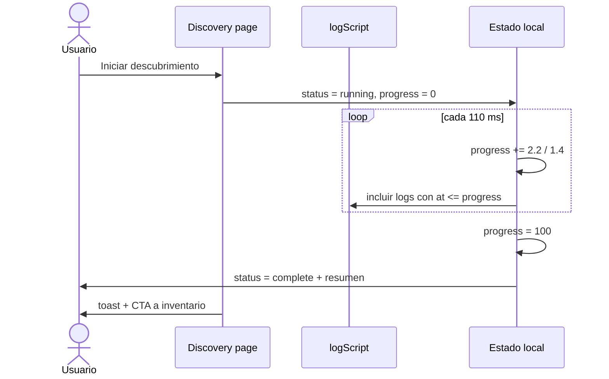
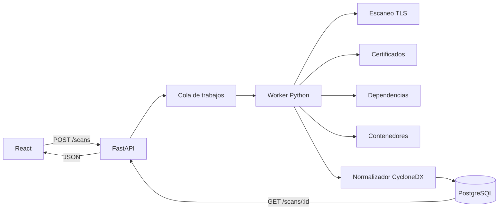

# 03 · Arquitectura

## 1. Vista general

UBIORA es una **SPA (Single Page Application)** construida con React 19, TypeScript y Vite. En esta fase no existe backend: el dominio, los datos y la simulación del motor viven en el cliente. La arquitectura está deliberadamente separada para que el motor real pueda conectarse sin reescribir la interfaz.



## 2. Stack y justificación

| Capa | Tecnología | Por qué |
| --- | --- | --- |
| UI | React 19 + TypeScript | Componentes, tipado estricto y ecosistema maduro. |
| Build | Vite 8 | Desarrollo rápido, build pequeño y configuración mínima. |
| Estilos | Tailwind CSS 4 + tokens CSS | Velocidad de iteración sin sacrificar un sistema visual propio. |
| Ruteo | React Router 7 | Rutas limpias, `NavLink` activo y parámetros de búsqueda. |
| Iconos | Lucide | Set consistente, ligero y accesible. |
| Tipografía | Fontsource (Geist, Geist Mono, Newsreader) | Fuentes auto-hospedadas; la demo no depende de Google Fonts. |
| Estado | `useState`, `useMemo`, Context | El alcance no justifica una librería global. |
| Datos | TypeScript + generador determinista | Reproducibilidad y cero infraestructura. |

### Por qué no Next.js

El MVP es una aplicación interna con cinco rutas, sin SSR, sin SEO y sin backend. Next.js añadiría un servidor y complejidad de despliegue sin beneficio para la demo. Si el producto evoluciona a un SaaS público con marketing y autenticación, la decisión se revisa en un ADR.

## 3. Estructura del código

```
app/src/
├── App.tsx                 # Providers + rutas
├── main.tsx                # Entrada y BrowserRouter
├── index.css               # Tailwind, tokens, utilidades, print
├── components/
│   ├── brand/Logo.tsx
│   ├── charts/             # Gauge, area chart, barras, sparkline
│   ├── layout/             # AppShell, Sidebar, TopBar
│   ├── ui/                 # Button, Badge, Panel, FilterSelect, Toast, CommandPalette
│   ├── RiskTable.tsx       # Tabla reutilizable de riesgos
│   └── RiskDrawer.tsx      # Detalle de activo (portal)
├── data/
│   ├── types.ts            # Contratos del dominio
│   ├── assets.ts           # Inventario, agregados y KPIs
│   └── roadmap.ts          # Fases, iniciativas y plazos NIST
├── lib/
│   ├── navigation.ts       # Configuración de navegación
│   ├── utils.ts            # cn, formatos, fechas
│   └── download.ts         # Descarga de archivos en cliente
└── pages/
    ├── Overview.tsx
    ├── Inventory.tsx
    ├── Discovery.tsx
    ├── Roadmap.tsx
    └── Report.tsx
```

## 4. Rutas

| Ruta | Módulo | Propósito |
| --- | --- | --- |
| `/` | Resumen de exposición | Postura general y prioridades. |
| `/descubrimiento` | Descubrimiento | Configurar y simular un escaneo. |
| `/inventario` | Inventario CBOM | Explorar los 1,284 componentes. |
| `/inventario?riesgo=Cr%C3%ADtico` | Inventario CBOM | Vista filtrada de críticos. |
| `/hoja-de-ruta` | Hoja de ruta | Plan de migración 2026–2030. |
| `/informe` | Informe ejecutivo | Documento imprimible. |

Cualquier ruta desconocida renderiza el resumen.

## 5. Flujo de datos

### 5.1 Carga

1. `data/assets.ts` construye los 1,284 activos: 27 curados + generación determinista.
2. Se calculan agregados una sola vez (`stats`, `algorithmFamilies`, `environmentBreakdown`).
3. Las páginas consumen esos agregados y aplican filtros locales.



### 5.2 Descubrimiento simulado



No se hace ninguna petición de red. La simulación existe para validar la experiencia de producto, no el motor.

### 5.3 Exportación

- **JSON:** se construye un objeto CycloneDX 1.7 en memoria, se serializa y se descarga con `Blob` + `URL.createObjectURL`.
- **CSV:** se escapan comillas, se antepone BOM UTF-8 y se descarga con el mismo mecanismo.

## 6. Estado y composición

| Estado | Dónde vive | Por qué |
| --- | --- | --- |
| Ruta activa | React Router | Fuente de verdad de la navegación. |
| Filtros, página, selección | `Inventory.tsx` | Estado local de la vista; no se comparte. |
| Drawer seleccionado | Página que lo abre | Cada tabla decide qué activo inspeccionar. |
| Toasts | `ToastProvider` | Comportamiento global y efímero. |
| Command palette | `CommandPaletteProvider` | Atajo global y navegación. |
| Workspace activo | `Sidebar.tsx` | Simulación visual; no afecta datos. |
| Escaneo | `Discovery.tsx` | Máquina de estados local (`idle`, `running`, `complete`). |

No se usa Redux/Zustand porque no hay estado compartido complejo ni caché de servidor. Si se agrega backend, se evaluará TanStack Query para el estado remoto.

## 7. Decisiones de diseño técnico

| Decisión | Alternativa descartada | Razón |
| --- | --- | --- |
| Datos deterministas en cliente | Mock estático JSON gigante | Permite 1,284 registros sin un archivo inmanejable y mantiene reproducibilidad. |
| Gráficas SVG propias | Recharts / Chart.js | Control visual total, menor peso y estética diferenciada. |
| Drawer con portal | Render inline | Evita que el `transform` de la animación de página rompa `position: fixed`. |
| Tailwind + tokens CSS | Librería de componentes | Se evita el look genérico de un dashboard de plantilla. |
| Impresión del navegador | Generación de PDF en servidor | Cero dependencias y suficiente para la demo. |

Los detalles están en [`adr/`](adr/).

## 8. Rendimiento

- Build actual: ~451 kB JS (~131 kB gzip) y ~62 kB CSS (~11 kB gzip).
- Fuentes auto-hospedadas con `font-display: swap`.
- Las gráficas son SVG sin librerías de visualización.
- `useDeferredValue` en la búsqueda del inventario evita bloquear la escritura.
- No hay code splitting todavía; si el producto crece, el primer candidato es separar el informe y la hoja de ruta con `React.lazy`.

## 9. Seguridad y privacidad

- No hay llamadas a APIs externas en runtime.
- No se almacenan credenciales ni datos reales.
- Los archivos exportados se generan localmente.
- En la siguiente fase: autenticación OIDC, RBAC por workspace, cifrado en reposo, auditoría de accesos y aislamiento por tenant.

## 10. Integración futura con el motor real



Contrato propuesto:

```ts
POST /scans
{ target: string; environment: string; scopes: string[]; mode: 'fast' | 'deep' }

GET /scans/:id
{
  status: 'queued' | 'running' | 'complete' | 'failed'
  progress: number
  logs: { at: string; level: 'info' | 'warn' | 'error'; message: string }[]
  summary?: { total: number; critical: number; hybrid: number; duration: number }
}
```

La UI ya está preparada para este contrato: solo habría que sustituir el temporizador de `Discovery.tsx` por polling o SSE.

## 11. Despliegue

La app es estática. Opciones:

- **Vercel / Netlify / Cloudflare Pages** con fallback SPA a `index.html`.
- **GitHub Pages** requiere configurar `base` en Vite y un fallback de rutas.
- Servidor propio con Nginx:

```nginx
location / {
  try_files $uri $uri/ /index.html;
}
```

No se requiere variable de entorno en esta fase.
