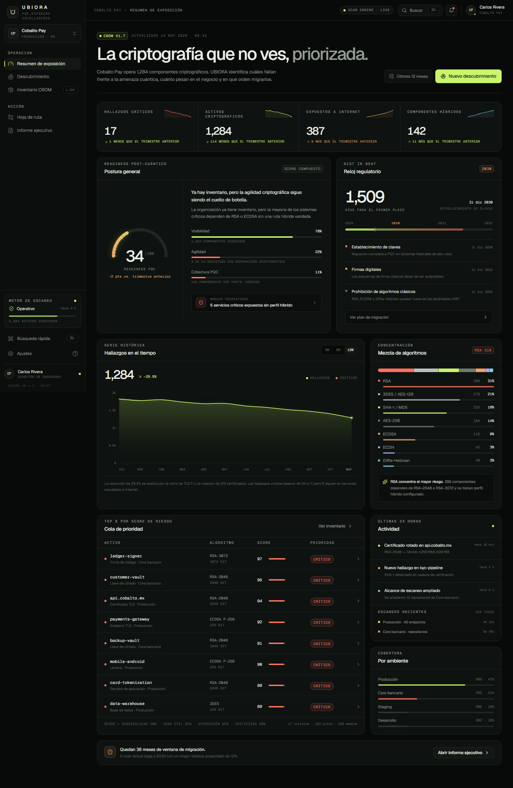
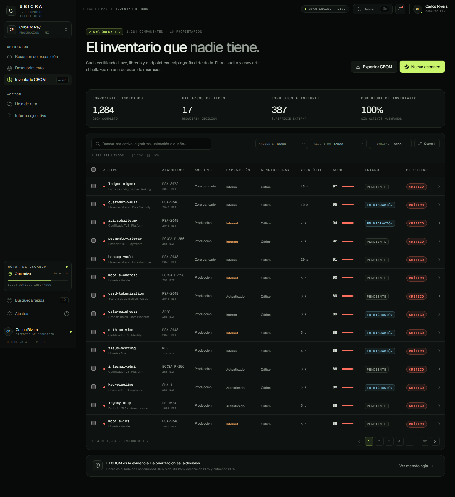
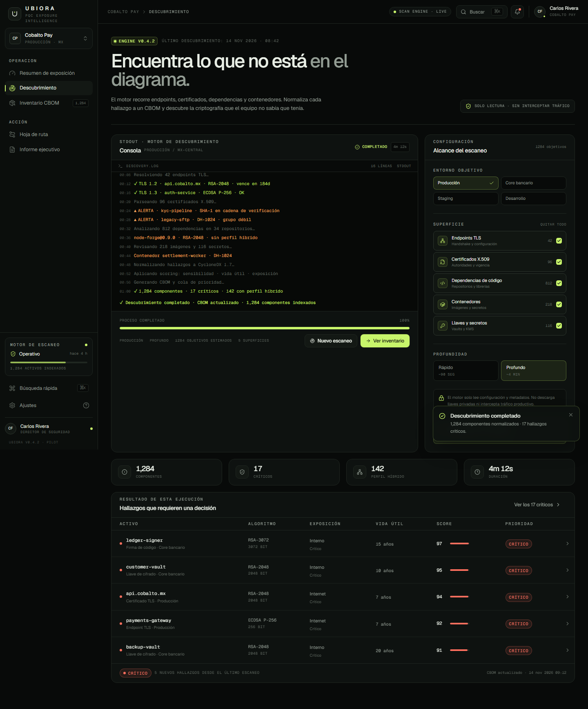
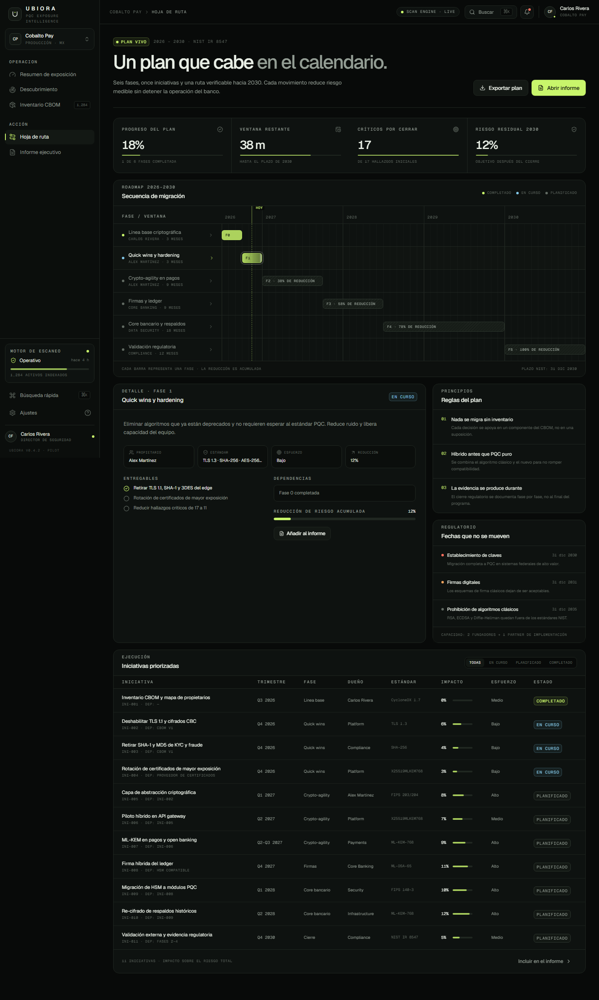
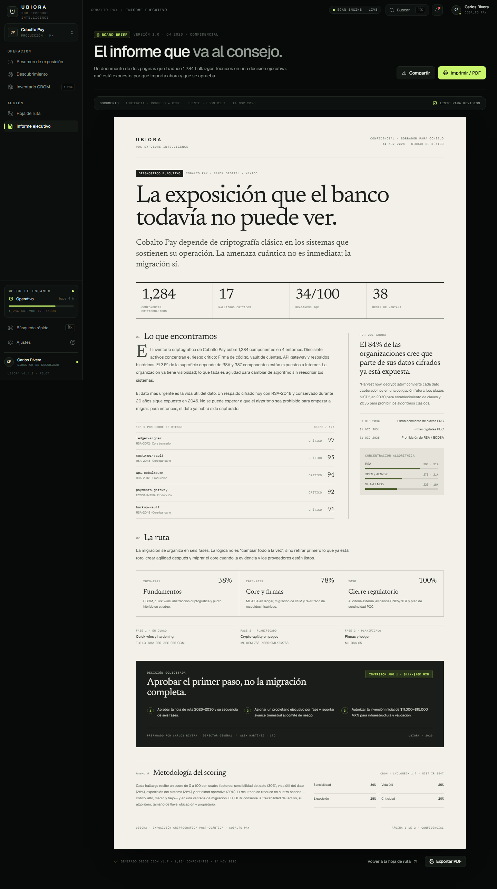
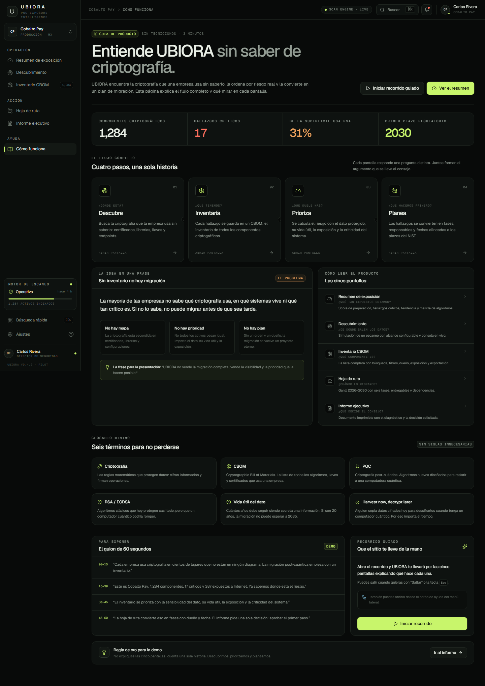

# Documentación de UBIORA

Este directorio reúne la documentación de producto e ingeniería del MVP. Está pensada para que cualquier integrante del equipo —o un evaluador— pueda entender qué se construyó, por qué y cómo extenderlo.

## Orden de lectura

| # | Documento | Para quién | Tiempo |
| --- | --- | --- | --- |
| 1 | [Producto y alcance](01-producto-y-alcance.md) | Producto, negocio, jurado | 8 min |
| 2 | [Requerimientos](02-requerimientos.md) | Producto, QA, ingeniería | 10 min |
| 3 | [Arquitectura](03-arquitectura.md) | Ingeniería | 12 min |
| 4 | [Datos y scoring](04-datos-y-scoring.md) | Ingeniería, riesgo, jurado técnico | 8 min |
| 5 | [Diseño de interfaz](05-diseno-de-interfaz.md) | Diseño, frontend | 8 min |
| 6 | [Calidad y pruebas](06-calidad-y-pruebas.md) | QA, ingeniería | 6 min |
| 7 | [Plan de entrega y demo](07-plan-de-entrega-y-demo.md) | Todo el equipo | 8 min |
| 8 | [Guía de uso y recorrido guiado](08-guia-de-uso.md) | Exposición, nuevas incorporaciones | 5 min |
| 9 | [ADRs](adr/) | Ingeniería | 6 min |

## Estado del proyecto

| Área | Estado | Nota |
| --- | --- | --- |
| Interfaz web | Listo para demo | Cinco módulos navegables y responsive. |
| Datos | Simulados, deterministas | 1,284 componentes; sin backend. |
| Motor de escaneo | Simulado en cliente | La integración real se documenta como siguiente fase. |
| Scoring | Implementado sobre datos simulados | Pesos y bandas documentados. |
| Exportación CBOM | Funcional en cliente | JSON con estructura CycloneDX 1.7 y CSV. |
| Informe ejecutivo | Listo para imprimir | Estilos `@media print` incluidos. |
| Ayuda en producto | Listo | Guía “Cómo funciona” y recorrido guiado de cinco pasos. |
| Pruebas automatizadas | Básicas | Build + typecheck; sin suite E2E todavía. |

## Capturas

| Módulo | Captura |
| --- | --- |
| Resumen de exposición |  |
| Inventario CBOM |  |
| Descubrimiento |  |
| Hoja de ruta |  |
| Informe ejecutivo |  |
| Guía “Cómo funciona” |  |

## Convenciones de esta documentación

- Los documentos describen el **MVP actual**, no el producto final.
- Cuando una capacidad es simulada se indica explícitamente.
- Los enlaces a código apuntan a rutas relativas al repositorio.
- Las decisiones con impacto técnico se registran como ADR en [`adr/`](adr/).
